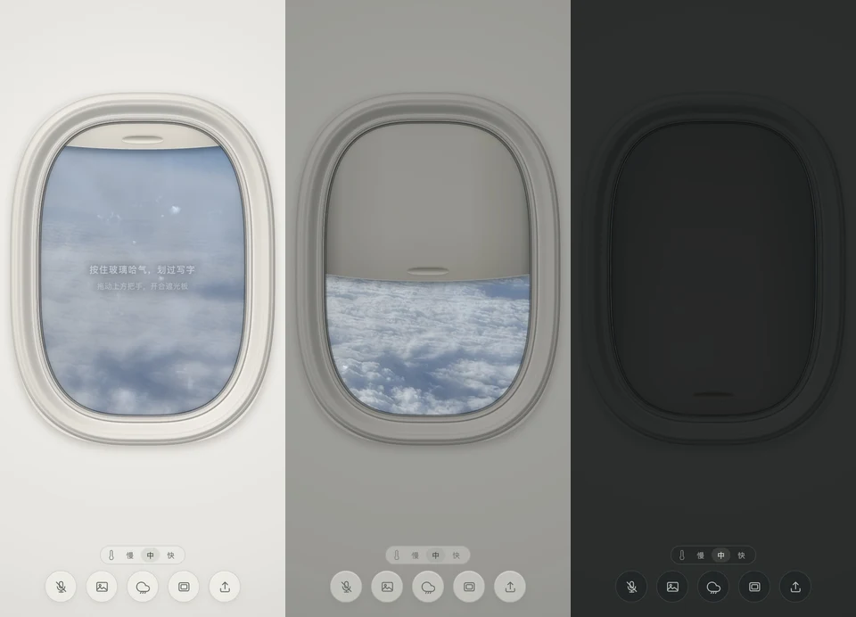
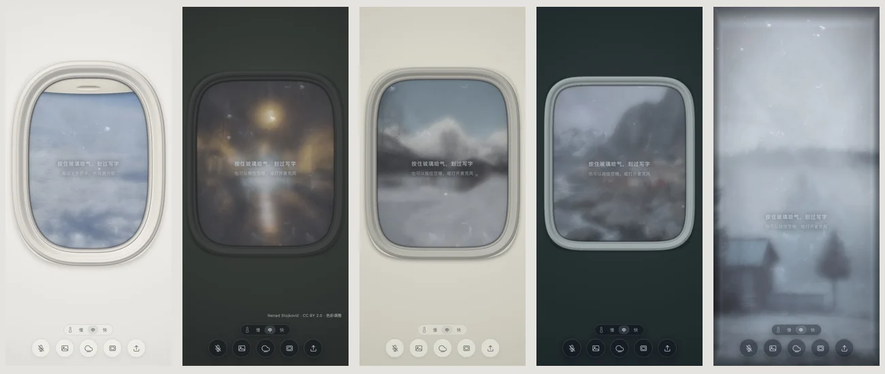

# 哈气 · Mistpane



> 窗外的灯还亮着。在玻璃上，写一个字。

**[在线体验](https://mistpane.vercel.app)** · [飞机舷窗](https://mistpane.vercel.app/?window=4) · [雨夜街头](https://mistpane.vercel.app/?scene=6) · [原质感对照](https://mistpane.vercel.app/?look=original)

一扇可以哈气、擦雾、写字的窗。八张颜色安静的风景：雾林、雪谷、雪地暖灯、冷海、云海、日落与两条雨夜街道。飞机舷窗的遮光板可以上下拖动，开合时，室内光线跟着变暗或变亮。



## 怎么玩

- 长按画面，或按住空格，让玻璃起雾；拖动手指或鼠标擦开。
- 底部可以打开麦克风、切换照片、随机天气、切换窗型、上传自己的照片。
- 双击画面也能切换天气；「慢 / 中 / 快」控制雾气消散。
- 拖动飞机舷窗的把手或遮光板，可以停在中间；轻点把手打开 / 关闭。键盘方向键调节，Home 打开、End 关闭。
- 无框玻璃，以及车窗、火车窗、渡轮方窗和飞机舷窗。切换窗型时会带出一张搭配的预设照片，仍可自行切换背景；上传的照片会保留。

上传的照片只在当前浏览器内使用，不发送到服务器。麦克风不可用时，可以长按或用空格完成相同的手动体验。

## 本地运行

```sh
npm run dev
npm run build
```

无运行依赖和外部 CDN，`dist/` 可以直接部署到静态托管。渲染采用 WebGL1，失败时使用简化 Canvas2D 效果。浏览器脚本以 Chrome 61 的语法和 API 为目标；旧内核和手机真机仍需实测。

默认是更柔和、遮盖力更强的雾层；水滴与融化的模拟参数保持不变。`?look=previous` 可对照上一版雾层。在地址后加 `?look=original` 可对照原雾气质感。加 `?window=1` 至 `4` 直接查看四种模拟窗型，`?scene=0` 至 `7` 直接选背景。验收记录见 [docs/QA.md](docs/QA.md)。

## 素材与版权

代码使用 MIT 许可证。照片的展示授权与代码许可分开，详见 [LICENSES.md](LICENSES.md)。

## English

A winter window you can breathe on and draw through. Hold the screen or Space to fog the glass, then drag to reveal the view. Eight quiet landscapes sit behind a frameless pane or four cabin windows. Drag the aircraft shade to change the cabin light, with inertia and a soft return at the ends. Cloud parallax and a drifting foreground layer add depth. The layout adapts to portrait and landscape phones; reduced-motion preferences stop cloud motion. Uploaded photographs stay in your browser. Built with WebGL1 and a simplified Canvas2D fallback, with no runtime dependencies.
