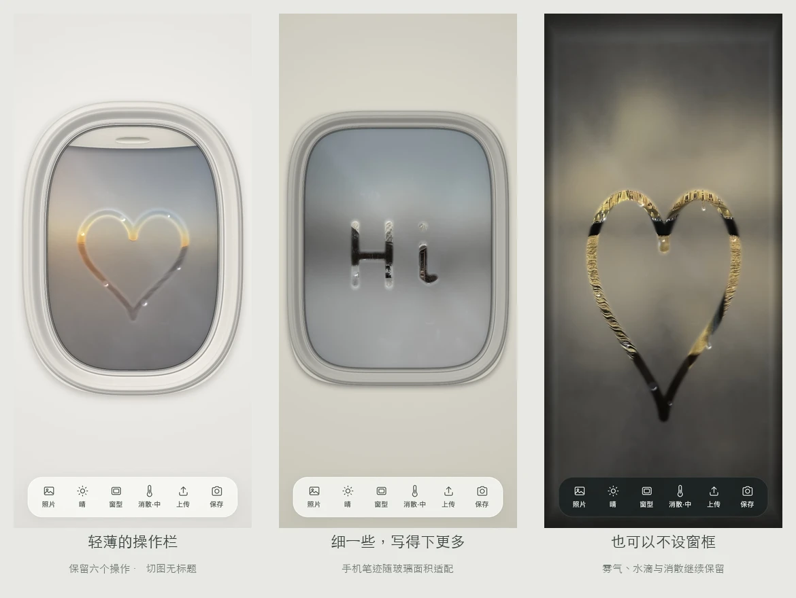

# 哈气 · Mistpane



> 窗外的灯还亮着。在玻璃上，写一个字。

**[在线体验](https://mistpane.vercel.app)** · [白色火车窗](https://mistpane.vercel.app/?window=2) · [无框玻璃](https://mistpane.vercel.app/?window=0)

一扇可以哈气、擦雾、写字的窗。阳光云海、雪地暖灯、暮色广场……8 张旅行照片，点一下就换一张。默认是白色飞机舷窗，拖动遮光板，房间的光线跟着变暗或变亮；也可以换成白色火车窗或全屏无框玻璃。

## 怎么玩

- 长按玻璃约 0.7 秒起雾，保持按住并拖动可以涂开雾气；松手后，再划就是擦雾写字。桌面也可按住空格哈气。
- 点「照片」直接切换下一张。保留原编号 01、02、03、04、07、14、18、20 的八张风景，换窗型时保留当前照片。
- 天气按钮依次切换「晴 → 雨 → 雪」。双击玻璃也可以；拖动写字不会触发换天气。
- 点「消散」在慢、中、快三档之间切换，三档均保留较慢的融化速度。雨量会自然渐强、渐弱，玻璃外侧的水珠断续滑落，留下湿痕。
- 拖动飞机舷窗的把手或遮光板，可停在中间；轻点打开 / 关闭。键盘方向键调节，Home 打开、End 关闭。
- 「上传」可以使用自己的照片，仅在当前浏览器内处理。
- 「保存」定格当下的窗景、雾字和水滴，导出不带操作按钮的 PNG。电脑直接下载；手机打开图片预览，可长按保存，或使用系统分享 / 下载。

六个操作收在轻薄的底部工具栏里；手机横屏变为右侧两列。触摸笔迹随玻璃面积适配，细一些，能留下更多书写空间。全部操作使用触摸或鼠标，不请求麦克风。

## 本地运行

```sh
npm run dev
npm run build
```

无运行依赖和外部 CDN，`dist/` 可部署到静态托管。采用 WebGL1，失败时使用简化 Canvas2D 效果。浏览器脚本以 Chrome 61 的语法和 API 为目标；旧内核和手机真机仍需实测。

`?window=4` 为飞机窗，`?window=2` 为火车窗，`?window=0` 为无框玻璃；`?scene=` 使用照片原编号减一，例如 14 号对应 `?scene=13`。已撤下照片的旧链接回到默认阳光云海。`?look=previous` 对照此前雾层，`?look=original` 对照原 HTML 质感。验收说明见 [docs/QA.md](docs/QA.md)。

## 素材与版权

代码使用 MIT 许可证。照片由项目创建者提供，仅授权在本项目中展示；照片授权与代码许可分开，详见 [LICENSES.md](LICENSES.md)。

## English

A winter window you can mist and draw through. Hold the glass, then drag to spread condensation; release and start a new stroke to wipe it away. Tap to cycle through eight travel photographs. Rain gradually changes intensity, with refracting droplets and wet trails on the outer glass; snow and clear weather are also available. White aircraft and train windows sit alongside a full-screen frameless view. Six tactile controls adapt to portrait and landscape screens. Save the current window, writing and droplets as a PNG without the controls. Mobile offers an image preview for long-press saving or system sharing. Uploaded photographs stay in your browser. No microphone permission; WebGL1 with a simplified Canvas2D fallback and no runtime dependencies.
