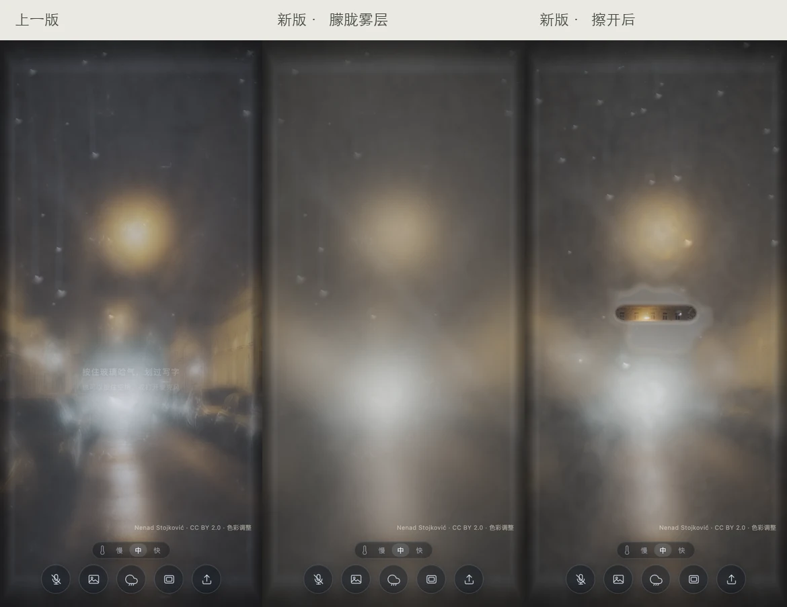

# 验收记录

## 2026-11-04 · v0.4.1 雾层

参考早期项目的散射方式，提前模糊背景细节，淡化清晰重影与固定灰迹；粗颗粒改为只随雾出现的细密凝结颗粒。光学颜色更中性，厚雾更朦胧。没有修改凝雾、笔刷、水滴、天气和融化参数。

验证：雨夜、飞机云层和雪谷三场景，在固定随机种子、同样输入和固定时间步下，新旧版擦拭后的雾密度、水膜、擦除历史、水滴与外侧雨滴状态完全一致；继续模拟 10 秒后仍完全一致。模拟代码段 SHA-256 也一致。

实时 Chrome + Metal：390×844 手机仿真约 60 fps，CPU 2.0–2.9ms；1440×900 桌面约 60 fps，4.8ms；Canvas2D 约 60 fps，2.5ms。手机长按、舷窗开合、原质感对照与简化渲染通过，无页面或控制台错误。真机仍未实测。

---

2026-11-03，v0.4。本机 Chrome headless + Metal GPU。手机为浏览器尺寸和触摸事件仿真，并非 iPhone / Android 真机。

## 视觉与交互

- 四种窗体重绘为连续受光的曲面；飞机舷窗使用暖白塑料、凹入的内沿、细接缝和软阴影。没有复制参考站的位图、模型或代码。
- 遮光板支持把手和整个板面拖动、任意位置停留、释放惯性、端点弹性返回、轻点开合。开合比例连续控制窗框、遮光板和室内背景的亮度。
- 云层使用照片视差与独立漂移的前景薄云；在雾气合成之前计算，因此擦开雾仍可看见运动的云。无需新增 GL 纹理，仍使用七个纹理单元。
- 保留桌面原 HTML 的凝雾、笔刷、蒸发参数，以及随机天气、三档消散、上传和麦克风功能。关闭遮光板后不向遮挡处输入呼气。
- 增加两张暖色雨夜街景，共八张背景；摄影许可与改动说明见 LICENSES.md。

## 实测

| 视口 | 内部 DPR | 稳定帧率 | 每帧 CPU |
| --- | --- | --- | --- |
| 1440×900，五种窗型 | 1.6 | 60 fps | 4.4–4.6 ms |
| 390×844，五种窗型 | 1.6 | 60 fps | 2.0–2.3 ms |
| 320×568，飞机窗 | 1.6 | 60 fps | 1.8 ms |
| 844×390，飞机窗 | 1.6 | 60 fps | 3.4 ms |

CPU 时间包括模拟、贴图上传和提交渲染命令，不等于 GPU 完成时间。截图采集和旋转重建期间会有短暂帧间隔增大，表格记录稳定运行时最近 120 帧。

通过以下实际浏览器输入检查，无页面异常或控制台错误：

- 触摸拖动跟随手指；停住再松手留在中间。板面本身也能拖，拖动时呼气强度为零。
- 快速松手后继续滑动；超出行程后返回端点。pointercancel、失焦不留下拖动状态。
- 完全关闭不漏出背景；开窗后触摸长按可达到约 0.998 的呼气强度，再拖动擦雾。
- 横竖屏转换保留开合比例，重新计算玻璃与照片的取景；所有窗框均能放进视口。
- 方向键 / Home / End、低动态偏好、无 PointerEvent 的触摸降级路径；低动态模式停止云层位移并取消释放惯性。
- 强制 Canvas2D 后仍能开合、明暗联动和手动起雾。
- 八张照片均加载；上传后切换窗型保留自定义图，切换场景可返回预设；原有天气和三档消散继续可用。
- `npm run build` 语法检查后生成静态目录，不包含原始素材与本地研究截图。

## 研究结论

[Mike Barton](https://www.mikes.cv/) 的实际页面使用前后窗框位图、位于中间的遮光板和窗外 WebGL 云层；开合驱动整页色调变化。层次清楚、接缝细、窗沿受光柔和，是本轮材质的主要参考。

[movin.design Window seat](https://movin.design/components/cards/window-seat/) 是 CSS 悬停 / 聚焦开窗的小组件，包含云层位移和低动态适配，不提供拖动惯性。本项目独立实现了拖动、阻尼与边界返回，并让玻璃表面继续接收雾气手势。

## 未实测

真实麦克风 / 真人气流和环境声；iPhone / Android 真机；Chrome 61 旧内核；小红书小工具容器。麦克风检测代码本轮未改，沿用之前的合成音频和拒绝授权验证结论，不声称能排除真实人声。

## 本地诊断

地址加 `?debug` 后，`window.__mist.stats()` 返回 FPS、CPU、雾密度、场景、开口、遮光板开合 / 速度 / 光照及渲染错误。普通入口没有调试界面。
